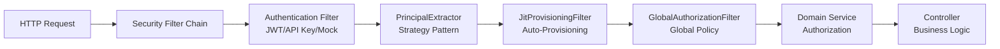

IDP-Core implements a flexible, modular authentication system based on Spring Security's filter chain architecture. This
document explains how the system works, how to configure it for different Identity Providers, and how to extend it with
custom authentication methods.

## Architecture Overview

The authentication system consists of five main components working together:



- **Security Filter Chain**: Routes requests through configured authentication mechanisms in order
- **Authentication Filters**: Extract credentials (JWT tokens, API keys, etc.) and create `Authentication` objects
- **Principal Extractor**: Converts authentication tokens into domain `PrincipalInfo` objects
- **JIT Provisioning Filter**: Automatically creates principals in the database on first authentication
- **Global Authorization Filter**: Enforces the global authorization policy in JWT, mock, and OAuth2 login chains
- **Domain Services**: Enforce business rules and authorization checks

## Filter Chain Architecture

IDP-Core uses a **multi-chain architecture** where each authentication mechanism has its own dedicated
`SecurityFilterChain` with a specific `@Order`. This allows:

- **Independent configuration** of each mechanism without interference
- **Environment-specific activation** using `@ConditionalOnProperty`
- **Clear precedence rules** via ordering (lower numbers evaluate first)
- **Flexible extensibility** for adding new mechanisms

### Filter Chain Ordering

Chains are evaluated in strict order of `@Order` value:

| Order | Chain                                   | Purpose                                                                 |
|-------|-----------------------------------------|-------------------------------------------------------------------------|
| 1     | `PublicFilterChainConfig`               | Permits public paths without authentication (actuator, swagger, health) |
| 2     | `JwtFilterChainConfig`                  | OAuth2 resource server with JWT validation                              |
| 3     | `ApiKeyFilterChainConfig`               | Simple API key authentication for webhooks and service-to-service       |
| 4+    | Future / Other authentication mechanism | Your custom authentication mechanisms                                   |
| last  | `MockFilterChainConfig`                 | Local development only - generates mock JWT tokens                      |

When a request arrives, Spring Security evaluates chains in order. The first chain whose `securityMatcher` matches the
request path handles that request. If no `securityMatcher` is specified, the chain protects all remaining unmatched
paths.

### Public Filter Chain (Order 1)

```java

@Configuration
- Classifies JWT principals using configured human-indicator claims
public class PublicFilterChainConfig {
    @Bean
    public SecurityFilterChain publicFilterChain(HttpSecurity http) throws Exception {
        http.securityMatcher("/", "/actuator/**", "/swagger-ui/**", "/v3/api-docs/**")
                .authorizeHttpRequests(auth -> auth.anyRequest().permitAll())
                .csrf(csrf -> csrf.disable());
        return http.build();
    }
}
```

The public chain explicitly permits these paths without any authentication. All other paths fall through to subsequent
chains.

### JWT Filter Chain (Order 2)

The JWT chain provides OAuth2 resource server authentication:

- Expects JWT tokens in the `Authorization: Bearer <token>` header
- Validates token signature using the configured JWKS endpoint
- Extracts claims and creates `JwtAuthenticationToken`
- Invokes claim mapping to standardize different IdP claim names
- Applies configured principal extraction to classify machine vs. human users

## JWT Claim Mappings

Different Identity Providers (IdPs) use different claim names in their JWT tokens for the same semantic meaning. The
claim mapping system allows you to configure these differences without code changes.

### OAuth2/OIDC Principal Identifier

Generic OAuth2 users use Spring Security's `OAuth2User.getName()`, which comes from the provider's configured
user-name attribute. For example, GitHub uses its stable numeric `id` as the principal name. OIDC users use the
standard `sub` claim. IDP-Core does not provide a separate setting to override either identifier. JWT resource-server
tokens use `app.security.authentication.principal-extraction`, described below.

### Optional Claim Mapping Configuration

Configure claim mappings in `application.yml` under `app.security.authentication.user-claim-mappings`:
When JWT authentication is enabled, these values are mandatory:

- spring.security.oauth2.resourceserver.jwt.jwk-set-uri required for signature validation.
- A valid JWT signature and the configured human identifier claim in human tokens.

When `app.security.authentication.jwt.enabled` is `false`, the JWT decoder and
JWT filter chain are not created, so `OAUTH_JWK_URI` is not required. Swagger
can be disabled independently with `app.security.swagger.enabled=false`; when
enabled without OAuth configuration, it publishes only the available security
schemes.

```yaml
app:
  security:
    authentication:
      user-claim-mappings:
        preferred_username: "preferred_username"  # Human-readable username
        name: "name"                    # Display name
        email: "email"                  # Email address
        groups: "groups"                # Group memberships
        client_id: "client_id"          # OAuth2 client identifier
        azp: "azp"                      # Authorized party (alternative client ID)
        grant_type: "grant_type"        # OAuth2 grant type
        gty: "gty"                      # Grant type variant
        service_name: "service_name"    # Custom M2M service identifier
```

### Common IdP Configurations

=== "Auth0"

```yaml
app:
  security:
    authentication:
      user-claim-mappings:
        preferred_username: "preferred_username"
        name: "name"
        email: "email"
        groups: "groups"
        client_id: "client_id"
        azp: "azp"
        grant_type: "grant_type"
        gty: "gty"
        service_name: "service_name"
```

=== "Keycloak"

```yaml

app:
  security:
    authentication:
      user-claim-mappings:
        preferred_username: "preferred_username"
        name: "name"
        email: "email"
        groups: "groups"
        client_id: "clientId"       # Note: camelCase in Keycloak
        azp: "azp"
        grant_type: "grant_type"
        gty: "gty"
        service_name: "service_name"
```

=== "Azure AD"

```yaml
app:
  security:
    authentication:
      user-claim-mappings:
        preferred_username: "unique_name"
        name: "name"
        email: "email"
        groups: "groups"
        client_id: "appid"
        azp: "appid"
        grant_type: "grant_type"
        gty: "gty"
        service_name: "custom_service_name"
```

When a JWT is received, the `PrincipalExtractor` uses these mappings to extract the actual claim values from the token,
ensuring that regardless of IdP differences, your application always receives standardized `PrincipalInfo` objects. If
the configured identifier claim is missing or blank, IDP-Core rejects the request with HTTP 401 and a standard JSON
error response. Local mock authentication includes the configured identifier claim in its generated token.

### How Claim Mappings Work

The extraction engine uses limited fallbacks for display data. It does not invent or fall back to an identifier because
that value keys provisioning, audit records, and authorization.

The extraction strategy doesn't just rename claims; it applies specific fallback rules if a mapped claim is missing from
the token:

| Principal field    | Mapping key                  | Fallback when the mapped claim is absent        |
|--------------------|------------------------------|-------------------------------------------------|
| `identifier`       |  JWT kind-specific `id-claim`| Request is rejected; the identifier is required |
| `name`             | `name`                       | `preferred_username`, then `identifier`         |
| `attributes.email` | `email`                      | Attribute omitted                               |
| `groups`           | `groups`                     | Empty list                                      |

### Example: UUID Identifier and Subject as Display Name

The following decoded JWT payload contains only fictional values.
It illustrates claim extraction, not a complete token for authentication.

```json
{
  "sub": "demo-user",
  "uuid": "00000000-0000-4000-8000-000000000001",
  "email": "demo-user@example.com"
}
```

To identify human tokens by `uuid` and use it as the human principal identifier, configure:

```yaml
app:
  security:
    authentication:
      principal-extraction:
        human-indicator-claims:
          - uuid
        human:
          id-claim: uuid
        machine:
          id-claim: client_id
          id-prefix: "machine:"
      user-claim-mappings:
        name: sub
        email: email
```

For a token classified as human, the extracted `PrincipalInfo` contains:

- `identifier`: `00000000-0000-4000-8000-000000000001`
- `kind`: `HUMAN`
- `name`: `demo-user`
- `attributes.email`: `demo-user@example.com`
- `groups`: `[]`

> [!WARNING]
> Changing the identifier mapping can provision a separate catalog principal.
> Choose a stable claim. IDP-Core does not automatically rename,
> merge, or look up previously provisioned principals when this setting changes.

## JWT Principal Classification

Service accounts are **machine-to-machine (M2M) credentials** used for service-to-service authentication (for example,
API clients, automation tools). Identifying them correctly is important for:

- Applying different authorization rules for services vs. humans
- Audit logging and security monitoring
- Rate limiting and quota management

Configure one or more human-indicator claims and separate identifier claims for human and machine tokens. A human token
must contain at least one configured indicator whose value includes a character other than whitespace. Otherwise,
IDP-Core classifies the token as a
machine principal. Machine principals use the existing `SERVICE_ACCOUNT` domain kind.

```yaml
app:
  security:
    authentication:
      principal-extraction:
        human-indicator-claims:
          - uuid
        human:
          id-claim: uuid
        machine:
          id-claim: client_id
          id-prefix: "machine:"
```

The selected `human.id-claim` or `machine.id-claim` must include a character other than whitespace. Otherwise,
IDP-Core rejects the request
with HTTP 401. `machine.id-prefix` is optional and applies only to the machine principal identifier. The provider's
raw `client_id` remains unchanged in principal attributes.

> [!IMPORTANT]
> Configure indicators that your provider guarantees are present only on human tokens. IDP-Core does not infer the
> OAuth grant type from `scope`, `client_id`, `grant_type`, or `token_type` claims. If no configured human indicator
> includes a character other than whitespace, IDP-Core selects the machine path, so the machine ID claim must be
> present.

## Principal Extraction

Once a JWT is validated and claims are mapped, the `PrincipalExtractor` converts the token into a domain `PrincipalInfo`
object.

### Extraction Strategy Pattern

The extraction system uses the **Strategy pattern** to support multiple token types:

```java
public PrincipalInfo extractPrincipalInfo(Authentication authentication) {
    if (authentication instanceof JwtAuthenticationToken jwtToken) {
        return extractFromJwt(jwtToken);
    }

    // Fallback for other authentication types
    return createFallbackPrincipal(authentication);
}
```

Each strategy:

1. Reads the configured human-indicator and kind-specific identifier claims
2. Classifies a token as human when any configured indicator includes a character other than whitespace; otherwise selects the machine path
3. Extracts the selected identifier and applies the optional machine prefix
4. Returns a unified `PrincipalInfo` domain object

### PrincipalInfo Domain Model

```java
public record PrincipalInfo(
        String identifier,                  // Unique ID (for example, email, username)
        PrincipalKind kind,                 // HUMAN or SERVICE_ACCOUNT
        String name,                        // Display name
        Map<String, String> attributes,     // Additional attributes
        List<String> groups                 // Group memberships
) {
}
```

## Just-In-Time (JIT) Provisioning

After successful authentication, the `JitProvisioningFilter` automatically creates a principal record in the database if
it doesn't exist. This enables:

- **Self-service access**: Users don't need manual provisioning before first login
- **Automatic sync**: User data stays in sync with the IdP
- **Reduced overhead**: No need to pre-populate users before they access the system

### How JIT Provisioning Works

1. Request passes through an authentication filter successfully
2. `JitProvisioningFilter` extracts the `PrincipalInfo` from Spring Security Context
3. Checks if the principal exists in the database (by identifier)
4. If not found, creates a new principal record with the extracted information
5. Continues to the controller

### Excluding Paths

Not all authenticated requests should trigger provisioning (for example, public paths, health checks). Configure
excluded paths in `application.yml`:

```yaml
app:
  security:
    authentication:
      jit-provisioning-excluded-paths:
        - "/"
        - "/actuator/**"
        - "/swagger-ui/**"
        - "/swagger-ui.html"
        - "/v3/api-docs/**"
```

> [!IMPORTANT]
> Keep the JIT excluded paths in sync with the `PublicFilterChainConfig` permission mechanism. If you add a public path
to one, add it to both.

## Global Authorization

The JWT, mock, and OAuth2 login API chains apply the global authorization policy after JIT provisioning. The dedicated
webhook ingestion chain remains separate and continues to use the security configured on each webhook connector.

In `GLOBAL` mode, the policy applies this matrix to supported HTTP actions. A configured global identifier bypasses
catalog and human-property checks; a principal entity with `is_admin: true` also receives the administrator access
shown below. Unsupported HTTP methods remain denied.

| Principal | Read access | Create, update, or delete |
| --- | --- | --- |
| Global identifier in `global-principal-identifiers` | All supported resources | All supported resources |
| Catalog admin (`is_admin: true`) | All supported resources, including audit | All supported resources |
| Service account | Entities, entity search, entity templates, and `/api/v1/entities/principals/me` | Denied |
| Human with gate disabled or required property set to `true` | Entities, entity search, entity templates, and `/api/v1/entities/principals/me` | Denied |
| Human with required property missing or `false` | Denied | Denied |

The entity routes include `GET /api/v1/entities/{templateIdentifier}` and
`GET /api/v1/entities/{templateIdentifier}/{entityIdentifier}`. Entity graph reads use
`/api/v1/entities/{templateIdentifier}/{entityIdentifier}/graph`. Entity-template reads use
`/api/v1/entity-templates` and `/api/v1/entity-templates/{identifier}`. The `POST /api/v1/entities/search` route is
treated as a read and is available to eligible non-admin humans and service accounts. Although
`POST /api/v1/entity_dynamic_mappings/dry-run` is also classified as read-only, its resource type is not in the
resources permitted for non-admin reads, so non-admin requests are denied. Audit history, dynamic-mapping management, and inbound
webhook configuration endpoints are also denied to non-admins. The inbound-webhook row refers to configuration
management, not webhook delivery, which uses a separate connector security chain.

The policy classifies `GET`, `HEAD`, and `OPTIONS` as reads. It treats `POST /api/v1/entities/search` and
`POST /api/v1/entity_dynamic_mappings/dry-run` as read actions, but the resource rules still determine whether
non-admins can access them. When configured, a human must have the named principal property set to `true` for any
non-admin access, including reads. If the property name is unset, this additional check is disabled. Missing or false
properties deny human access. Catalog admins and configured global identifiers bypass this property check; service
accounts do not use the human-property gate.

For example, set `IDP_REQUIRED_PRINCIPAL_PROPERTY=is_idp_user` to require that property. A trusted ingestion webhook
can populate or update it on principal entities; configure connector mappings so only an authoritative source can set
it. JIT does not derive the property from token claims, and it does not overwrite existing principal data. Before
enabling the gate, add the configured optional Boolean property to the `principal` template so the ingestion mapping
can validate and store it.

JWT humans and service accounts use their configured kind-specific IDs; machine IDs may include `machine.id-prefix`.
Generic OAuth2 users use the provider-configured principal name; OIDC users use `sub`. Break-glass values must match
the resulting principal identifiers
exactly. In `LINK_ONLY` mode, IDP-Core creates a missing principal for a configured global identifier. In JIT mode,
ordinary JIT provisioning creates a missing principal, and the global identifier still receives the authorization
bypass. Use an immutable, globally unique identifier, such as a UUID claim; the current allow-list is identifier-based
and does not scope entries by issuer. Configure one or both root identifiers through environment variables:

```yaml
app:
  security:
    authorization:
      mode: GLOBAL
      global-principal-identifiers: ${IDP_SUPER_ADMIN_IDENTIFIER:},${IDP_PLATFORM_ADMIN_IDENTIFIER:}
      required-principal-property: ${IDP_REQUIRED_PRINCIPAL_PROPERTY:}
```

IDP-Core provisions each principal directly under the configured identifier. It does not retain username aliases or
automatically migrate historical principal identifiers.

Ordinary JIT provisioning creates principals with `is_admin: false` and ignores `is_admin` and `kind` among extracted
attributes. In `LINK_ONLY` mode, when an authenticated identifier is on the global allow-list but has no linked
principal, IDP-Core creates a principal with `is_admin: true`. It does not change an existing principal; the configured
identifier still receives the global authorization bypass. In JIT mode, ordinary provisioning remains non-admin, but
the configured identifier still receives that authorization bypass. Do not map an untrusted identity claim to
`is_admin`. An authorized administrator or a trusted ingestion webhook can update this property. Normal service-account
API requests cannot write principal records, while the connector-authenticated webhook ingestion chain remains
separate. Restrict its mappings to authoritative sources because `is_admin` grants platform-wide access. Entity-template
permission or ownership settings are intentionally ignored in this phase. The former `baseline-role: "*"` assignment
has been removed; JWT authorities do not grant platform permissions.

The authorization request already identifies a principal, action, and resource. The next stage can add configurable
access profiles and resource/action permissions, with profile names stored as data.
The full rights matrix can then move to catalog entities and relations without changing the request shape. Until that
policy is implemented, the `RBAC` and `ABAC` modes fail closed; use `GLOBAL`.

## API Key Authentication

The `app.security.authentication.api-key` chain is currently only a conditional security-chain placeholder; it does
not validate an API-key credential or establish a service-account principal. Do not enable it as an authentication
mechanism until that authenticator is implemented. Inbound webhook delivery uses the separate connector-level security
validation described in [Webhook Security](webhooks.md#security-strategies).

### Enabling API Key Authentication

```yaml
app:
  security:
    authentication:
      api-key:
        enabled: true
```

API keys are provided via the `X-API-Key` header:

```bash
curl -H "X-API-Key: your-secret-key" https://api.example.com/api/v1/webhooks
```

The `ApiKeyFilterChainConfig` validates the key and creates an authenticated principal without requiring JIT
provisioning (API keys are pre-configured, not JIT-provisioned).

## Mock Authentication (Local Development)

For local development and testing, enable mock authentication to generate tokens without an IdP:

```yaml
app:
  security:
    authentication:
      mock:
        enabled: true
```

The `MockFilterChainConfig` generates a mock JWT token with configurable claims via request parameters:

```bash
curl -H "Authorization: Bearer mock?sub=test-user&email=test@example.com" \
  http://localhost:8080/api/v1/entities
```

> [!WARNING]
> Mock authentication must never be enabled in production. It bypasses all JWT validation and should only be used in
`local` or `test` Spring profiles.

## GitHub Authentication for Local Development

If you want to exercise the real user authentication path locally, use GitHub as the OAuth2 provider instead of the
mock filter. This setup exercises the same JIT provisioning flow as production-style authenticated requests:

1. Spring Security completes the OAuth2 login with GitHub.
2. `OAuth2LoginFilterChainConfig` stores the authenticated `OAuth2User` in the security context.
3. `JitProvisioningFilter` extracts a `PrincipalInfo` through `PrincipalExtractor`.
4. `PrincipalProvisioningService` creates or refreshes the `principal` entity on the first authenticated request.

### Local Profile Configuration

The `local` profile now expects a GitHub OAuth App and enables browser-based OAuth2 login.

```yaml title="src/main/resources/application-local.yml"
spring:
  security:
    oauth2:
      client:
        registration:
          github:
            client-id: ${GITHUB_CLIENT_ID}
            client-secret: ${GITHUB_CLIENT_SECRET}
            scope:
              - read:user
              - user:email

app:
  idp-core-prefix-url: http://localhost:8084
  security:
    authentication:
      jwt:
        enabled: false
      oauth2-login:
        enabled: true
      mock:
        enabled: false
      user-claim-mappings:
        preferred_username: login
        name: name
        email: email
```

### GitHub OAuth App Setup

Create a GitHub OAuth App and configure:

- Homepage URL: `http://localhost:8084`
- Authorization callback URL: `http://localhost:8084/login/oauth2/code/github`

Export the client credentials before you start the app:

```bash
export SPRING_PROFILE=local
export GITHUB_CLIENT_ID=your-github-client-id
export GITHUB_CLIENT_SECRET=your-github-client-secret
./mvnw spring-boot:run
```

Then open `http://localhost:8084/oauth2/authorization/github` in your browser. After the callback succeeds, the next
authenticated request to `/api/v1/**` provisions the GitHub user in the catalog automatically.
