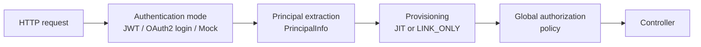

IDP-Core separates three concerns. **Authentication** proves who calls the API. **Principal provisioning** turns that
identity into a catalog record. **Authorization** decides what that principal can do.



## Authentication modes

Each mode has its own `SecurityFilterChain` that you enable with a property. Public paths (health, Swagger, API docs)
bypass authentication.

| Mode                                        | Enable with                                        | Use for                           |
| ------------------------------------------- | -------------------------------------------------- | --------------------------------- |
| [JWT resource server](#jwt-resource-server) | `app.security.authentication.jwt.enabled`          | Production API calls (users, M2M) |
| [OAuth2 login](#oauth2-login)               | `app.security.authentication.oauth2-login.enabled` | Browser login, for example GitHub |
| [Mock](#mock-authentication)                | `app.security.authentication.mock.enabled`         | Local development only            |
| [API key](#api-key)                         | `app.security.authentication.api-key.enabled`      | Not usable yet (placeholder)      |

> [!WARNING]
> Never enable mock authentication in production. It skips all token validation.

### JWT resource server

The JWT chain validates `Authorization: Bearer <token>` requests as an OAuth2 resource server. It validates the
signature against the identity provider (IdP) JWKS endpoint, then hands the token to principal extraction.

```yaml title="application.yml"
spring:
  security:
    oauth2:
      resourceserver:
        jwt:
          jwk-set-uri: ${OAUTH_JWK_URI}

app:
  security:
    authentication:
      jwt:
        enabled: true
```

When `jwt.enabled` is `false`, IDP-Core creates neither the JWT decoder nor the JWT chain, so `OAUTH_JWK_URI` isn't
required. You can disable Swagger independently with `app.security.swagger.enabled=false`. When you enable Swagger
without OAuth configuration, it publishes only the available security schemes.

#### Map IdP claims

Identity providers name the same claim differently. Map them under `app.security.authentication.user-claim-mappings`:

=== "Auth0"

    ```yaml
    app:
      security:
        authentication:
          user-claim-mappings:
            preferred_username: "preferred_username"
            name: "name"
            email: "email"
            groups: "groups"
    ```

=== "Keycloak"

    ```yaml
    app:
      security:
        authentication:
          user-claim-mappings:
            preferred_username: "preferred_username"
            name: "name"
            email: "email"
            groups: "groups"
            client_id: "clientId"   # camelCase in Keycloak
    ```

=== "Azure AD"

    ```yaml
    app:
      security:
        authentication:
          user-claim-mappings:
            preferred_username: "unique_name"
            name: "name"
            email: "email"
            groups: "groups"
            client_id: "appid"
    ```

#### Classify human and machine tokens

IDP-Core must decide whether a token represents a person or a service. Configure claims that only human tokens carry,
plus the identifier claim for each kind:

```yaml
app:
  security:
    authentication:
      principal-extraction:
        human-indicator-claims:
          - email
        human:
          id-claim: email
        machine:
          id-claim: client_id
          id-prefix: "machine:"
```

A token is human when at least one indicator claim has a non-blank value. Otherwise, IDP-Core treats it as a machine
principal (`SERVICE_ACCOUNT`). The selected identifier claim must be non-blank, or IDP-Core rejects the request with
HTTP 401. `machine.id-prefix` is optional and only affects the machine identifier.

> [!IMPORTANT]
> Use indicators that your provider sets only on human tokens. IDP-Core doesn't infer the kind from `scope`,
> `client_id`, `grant_type`, or `token_type`.

### OAuth2 login

OAuth2 login runs the browser authorization-code flow through Spring Security. It's the closest local equivalent of
real user authentication. The following example uses GitHub:

```yaml title="src/main/resources/application-local.yml"
spring:
  security:
    oauth2:
      client:
        registration:
          github:
            client-id: ${GITHUB_CLIENT_ID}
            client-secret: ${GITHUB_CLIENT_SECRET}
            scope:
              - read:user
              - user:email

app:
  idp-core-prefix-url: http://localhost:8084
  security:
    authentication:
      jwt:
        enabled: false
      oauth2-login:
        enabled: true
      mock:
        enabled: false
      user-claim-mappings:
        preferred_username: login
        name: name
        email: email
```

Create a GitHub OAuth App with these settings:

- Homepage URL: `http://localhost:8084`
- Authorization callback URL: `http://localhost:8084/login/oauth2/code/github`

Start the application, then open `http://localhost:8084/oauth2/authorization/github`:

```bash
export SPRING_PROFILE=local
export GITHUB_CLIENT_ID=your-github-client-id
export GITHUB_CLIENT_SECRET=your-github-client-secret
./mvnw spring-boot:run
```

After the callback succeeds, the next authenticated request to `/api/v1/**` provisions the GitHub user.

### Mock authentication

Mock authentication injects a fixed JWT for every request, so you can work without an IdP:

```yaml
app:
  security:
    authentication:
      mock:
        enabled: true
```

The token has `sub` and `preferred_username` set to `local-developer`, `email` set to `developer@local.dev`, and the
`ROLE_USER` and `ROLE_API_CLIENT` authorities. The mock principal passes through the same extraction, provisioning, and
authorization steps as a real token. Include your configured human indicator claim in the mock token if you need a
human principal.

### API key

The `app.security.authentication.api-key` chain is a placeholder. It doesn't validate credentials or establish a
principal, so don't enable it. Inbound webhook delivery uses connector-level validation instead. See
[Webhook Security](webhooks.md#security-strategies).

### Chain ordering

Spring Security uses the first chain whose `securityMatcher` matches the request. Lower `@Order` values run first:
`PublicFilterChainConfig` (1), `JwtFilterChainConfig` (2), `ApiKeyFilterChainConfig` (3), and
`MockFilterChainConfig` (4). Keep the paths excluded from provisioning in sync with the public chain.

## Principals and provisioning

### What is a principal

A principal is the authenticated caller, stored in the catalog as an entity of the `principal` template. It's the key
for provisioning, audit records, and authorization. IDP-Core represents it in code as `PrincipalInfo`:

```java
public record PrincipalInfo(
        String identifier,                  // Stable unique ID
        PrincipalKind kind,                 // HUMAN or SERVICE_ACCOUNT
        String name,                        // Display name
        Map<String, String> attributes,     // For example, email
        List<String> groups                 // Group memberships
) {
}
```

| Kind              | Represents                           |
| ----------------- | ------------------------------------ |
| `HUMAN`           | A person who signs in through an IdP |
| `SERVICE_ACCOUNT` | A machine-to-machine (M2M) client    |

### Choose the identifier

The identifier is never guessed or substituted. A missing or blank identifier returns HTTP 401.

| Authentication mode         | Identifier source                                             |
| --------------------------- | ------------------------------------------------------------- |
| JWT human token             | `principal-extraction.human.id-claim`                         |
| JWT machine token           | `principal-extraction.machine.id-claim`, plus optional prefix |
| OAuth2 login                | Provider-configured principal name (GitHub uses numeric `id`) |
| OpenID Connect (OIDC) login | Standard `sub` claim                                          |
| Mock                        | `sub` (`local-developer`)                                     |

IDP-Core has no setting to override the OAuth2 or OIDC identifier.

> [!WARNING]
> Changing an identifier mapping provisions a new principal. IDP-Core doesn't rename, merge, or look up principals that
> it provisioned earlier. Choose a stable, globally unique claim such as a UUID.

### Extract the other fields

The other fields use limited fallbacks:

| Principal field    | Mapping key | Fallback when absent                  |
| ------------------ | ----------- | ------------------------------------- |
| `name`             | `name`      | `preferred_username`, then identifier |
| `attributes.email` | `email`     | Attribute omitted                     |
| `groups`           | `groups`    | Empty list                            |

For example, with `human.id-claim: uuid` and `user-claim-mappings.name: sub`, this fictional payload:

```json
{
  "sub": "demo-user",
  "uuid": "00000000-0000-4000-8000-000000000001",
  "email": "demo-user@example.com"
}
```

produces a `HUMAN` principal with identifier `00000000-0000-4000-8000-000000000001`, name `demo-user`, and
`attributes.email` set to `demo-user@example.com`.

### Provisioning modes

After authentication, `JitProvisioningFilter` links the caller to a `principal` entity. The
`app.security.principal-provisioning.mode` flag controls what happens when no principal exists for the identifier:

```yaml
app:
  security:
    principal-provisioning:
      mode: ${IDP_PRINCIPAL_PROVISIONING_MODE:LINK_ONLY}
```

| Mode        | Missing principal                                                  | Use for                                          |
| ----------- | ------------------------------------------------------------------ | ------------------------------------------------ |
| `JIT`       | IDP-Core creates it from the token, so first login self-provisions | Open access where the IdP is the source of truth |
| `LINK_ONLY` | IDP-Core rejects the request with HTTP 401                         | Controlled access: principals exist beforehand   |

The flag defaults to `JIT` when you leave it unset, but `application.yml` sets `LINK_ONLY`. Set
`IDP_PRINCIPAL_PROVISIONING_MODE` to change it.

#### JIT mode

1. `PrincipalExtractor` converts the `Authentication` to `PrincipalInfo`.
2. `PrincipalProvisioningService` creates the principal when it's missing.
3. IDP-Core looks the principal up again and continues the request. If no principal matches, it returns HTTP 401.

#### LINK_ONLY mode

IDP-Core never creates principals from token data. A principal must exist already, for example from an ingestion
webhook or an administrator.

1. `PrincipalExtractor` converts the `Authentication` to `PrincipalInfo`.
2. IDP-Core looks up the linked principal by identifier.
3. If found, the request continues.
4. If missing and the identifier isn't a [break-glass identifier](#break-glass-identifiers), IDP-Core returns HTTP 401
   with `No linked principal matches the authenticated identity`.
5. If missing and the identifier is a break-glass identifier, IDP-Core creates the principal with `is_admin: true`.

A failure in provisioning itself, such as a database error, is logged and the request continues. A missing or blank
identifier always returns HTTP 401 in both modes.

#### Excluded paths

Exclude public paths from provisioning in either mode:

```yaml
app:
  security:
    authentication:
      jit-provisioning-excluded-paths:
        - "/"
        - "/actuator/**"
        - "/swagger-ui/**"
        - "/swagger-ui.html"
        - "/v3/api-docs/**"
```

JIT provisioning always creates the principal with `is_admin: false`. It ignores `is_admin` and `kind` from extracted
attributes, and it doesn't overwrite existing principal data.

> [!WARNING]
> Don't map an untrusted identity claim to `is_admin`. Only an authorized administrator or a trusted ingestion webhook
> should change it.

## Authorization

The JWT, mock, and OAuth2 login chains apply the authorization policy after provisioning. Webhook ingestion uses its
own chain and the security configured on each connector.

### Global mode

`GLOBAL` is the only available mode. The `RBAC` and `ABAC` modes fail closed until their policies exist.

| Principal                                            | Read access                                                                 | Create, update, delete  |
| ---------------------------------------------------- | --------------------------------------------------------------------------- | ----------------------- |
| Global identifier in `global-principal-identifiers`  | All supported resources                                                     | All supported resources |
| Catalog admin (`is_admin: true`)                     | All supported resources, including audit                                    | All supported resources |
| Service account                                      | Entities, entity search, entity templates, `/api/v1/entities/principals/me` | Denied                  |
| Human with gate disabled or required property `true` | Same as service account                                                     | Denied                  |
| Human with required property missing or `false`      | Denied                                                                      | Denied                  |

The policy classifies `GET`, `HEAD`, and `OPTIONS` as reads. It also treats `POST /api/v1/entities/search` and
`POST /api/v1/entity_dynamic_mappings/dry-run` as reads. Resource rules still decide access, so non-admins can search
entities but can't call the dry-run endpoint. Audit history, dynamic-mapping management, and inbound webhook
configuration are admin-only. Unsupported HTTP methods are denied.

### Break-glass identifiers

Configure root identifiers that bypass catalog and human-property checks:

```yaml
app:
  security:
    authorization:
      mode: GLOBAL
      global-principal-identifiers: ${IDP_SUPER_ADMIN_IDENTIFIER:},${IDP_PLATFORM_ADMIN_IDENTIFIER:}
      required-principal-property: ${IDP_REQUIRED_PRINCIPAL_PROPERTY:}
```

Values must match the resulting principal identifier exactly, and the allow-list doesn't scope entries by issuer. Use
an immutable, globally unique identifier. In `LINK_ONLY` mode, IDP-Core creates a missing principal for a global
identifier with `is_admin: true`. It never changes an existing principal. In `JIT` mode, the principal is created as
non-admin, but the identifier still bypasses authorization. See
[Provisioning modes](#provisioning-modes).

### Require a human property

Set `required-principal-property` (for example, `IDP_REQUIRED_PRINCIPAL_PROPERTY=is_idp_user`) to require that a human
principal has the property set to `true` for any non-admin access, including reads. An empty value disables the gate.
Service accounts, catalog admins, and global identifiers skip it.

Add the property as an optional Boolean on the `principal` template before you enable the gate. A trusted ingestion
webhook can then populate it. JIT never derives it from token claims. Restrict webhook mappings to authoritative
sources.

### What comes next

The authorization request already identifies the principal, action, and resource. A later stage can add configurable
access profiles and resource/action permissions without changing that shape. JWT authorities don't grant platform
permissions.

---

## Next Steps

- **[Webhook Security](webhooks.md#security-strategies)** - Connector-level security for inbound webhooks
