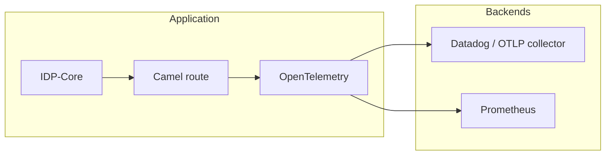

The Internal Developer Platform emits metrics, logs, and traces through Spring Boot and OpenTelemetry, with Camel instrumentation enabled for the webhook ingestion flow.



The app exposes health endpoints and uses OTLP export for traces and metrics when enabled. The standard OpenTelemetry variables remain the integration point for the environment, not vendor-specific configuration.

## Metrics

### Metrics exported by Spring Boot and Micrometer

The application exposes the standard Micrometer metrics and OTLP export can be enabled through environment variables.

```yaml
management:
  tracing:
    sampling:
      probability: ${OTEL_TRACES_SAMPLER_ARG:0.1}
    export:
      enabled: ${OTEL_TRACING_ENABLED:false}

  otlp:
    metrics:
      export:
        url: ${OTEL_EXPORTER_OTLP_METRICS_ENDPOINT:${OTEL_EXPORTER_OTLP_ENDPOINT:http://localhost:4318}/v1/metrics}
        enabled: ${OTEL_METRICS_EXPORT_ENABLED:false}
        transport: ${OTEL_EXPORTER_OTLP_METRICS_PROTOCOL:${OTEL_EXPORTER_OTLP_PROTOCOL:http/protobuf}}

  opentelemetry:
    tracing:
      export:
        otlp:
          endpoint: ${OTEL_EXPORTER_OTLP_TRACES_ENDPOINT:${OTEL_EXPORTER_OTLP_ENDPOINT:http://localhost:4318}/v1/traces}
          transport: ${OTEL_EXPORTER_OTLP_TRACES_TRANSPORT:${OTEL_EXPORTER_OTLP_PROTOCOL:http}}
    resource-attributes:
      deployment.environment: ${OTEL_ENV:local}
      service.namespace: ${OTEL_SERVICE_NAMESPACE:idp-core}
      service.name: ${OTEL_SERVICE_NAME:internal-developer-platform}
```

### Custom business metrics

Business-level metrics are intentionally separate from Camel route telemetry. The application adds custom counters only for functional decisions that Camel does not expose as a reusable business signal.

Examples:

- `idp.webhook.security.requests.total{connector, security_type}`
- `idp.webhook.security.result{connector, security_type, result}`
- `idp.webhook.security.validation.errors.total{connector, security_type, reason}`

These metrics reflect the real security decision made by the application and should not duplicate the standard Camel `route.*` metrics.

## Logging

Logs remain useful for debugging and operational incidents, but they are not the primary analytics signal. The main operational signals are traces and metrics.

The application configuration keeps log filtering under `logging.level.*` and actuator health endpoints under `management.endpoint.health`.

## Distributed tracing

OpenTelemetry tracing is enabled through Spring Boot configuration. The application keeps the trace sampling rate and OTLP exporter configurable through environment variables.

### Standard environment variables

| Variable | Description | Default |
| --- | --- | --- |
| `OTEL_TRACING_ENABLED` | Enables tracing export | `false` |
| `OTEL_METRICS_EXPORT_ENABLED` | Enables OTLP metrics export | `false` |
| `OTEL_TRACES_SAMPLER_ARG` | Trace sampling ratio | `0.1` |
| `OTEL_EXPORTER_OTLP_ENDPOINT` | Base OTLP endpoint | `http://localhost:4318` |
| `OTEL_EXPORTER_OTLP_TRACES_ENDPOINT` | Full traces endpoint | `<base>/v1/traces` |
| `OTEL_EXPORTER_OTLP_METRICS_ENDPOINT` | Full metrics endpoint | `<base>/v1/metrics` |
| `OTEL_EXPORTER_OTLP_PROTOCOL` | Generic OTLP protocol fallback | `http/protobuf` for metrics, `http` for traces |
| `OTEL_EXPORTER_OTLP_TRACES_TRANSPORT` | Trace-specific transport override | `OTEL_EXPORTER_OTLP_PROTOCOL` or `http` |
| `OTEL_EXPORTER_OTLP_METRICS_PROTOCOL` | Metrics-specific transport override | `OTEL_EXPORTER_OTLP_PROTOCOL` |
| `OTEL_RESOURCE_ATTRIBUTES` | Resource metadata injected by the environment | - |

The signal-specific variables win over the generic fallback, so local development and hosted deployments can both work without hard-coded vendor configuration.

### Important trace attributes

The application sets trace attributes for the webhook pipeline, including the connector identifier and the security decision.

Examples:

- `idp.webhook.identifier`
- `idp.webhook.security.result`

These attributes support trace correlation in Datadog APM and allow support teams to trace a request across route execution, security validation, and mapping.

## Health checks

The app exposes health endpoints used by Docker and Kubernetes.

| Endpoint                     | Purpose              |
|------------------------------|----------------------|
| `/actuator/health`           | Overall health       |
| `/actuator/health/liveness`  | Liveness probe       |
| `/actuator/health/readiness` | Readiness probe      |

## Next steps

- **[Configuration](configuration.md)** - Environment and Spring Boot settings
- **[Docker](docker.md)** - Docker deployment and OTLP examples
- **[Kubernetes](kubernetes.md)** - Production deployment patterns
