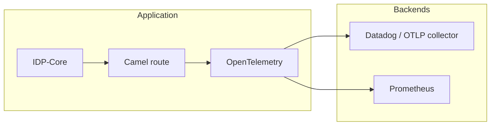

The Internal Developer Platform emits metrics, logs, and traces through Spring Boot and OpenTelemetry, with Camel instrumentation enabled for the webhook ingestion flow.



The app exposes health endpoints and uses OTLP export for traces and metrics when enabled. The standard OpenTelemetry variables remain the integration point for the environment, not vendor-specific configuration.

## Metrics

### Native OpenTelemetry metrics

The application uses `io.opentelemetry.instrumentation:opentelemetry-spring-boot-starter` to configure the SDK, metric readers, and OTLP exporters. You do not need application-defined `OpenTelemetry` or `SdkMeterProvider` beans. The ingestion processors use the auto-configured instance.

```yaml title="application.yml"
otel:
  metrics:
    exporter: ${OTEL_METRICS_EXPORTER:otlp}
  exporter:
    otlp:
      endpoint: ${OTEL_EXPORTER_OTLP_ENDPOINT:http://localhost:4318}
      protocol: ${OTEL_EXPORTER_OTLP_PROTOCOL:http/protobuf}
```

The previous Spring Boot starter exported Micrometer metrics. Its SDK configuration could attach an existing meter provider, but did not create one for these native instruments. Setting `management.opentelemetry.metrics.export.otlp.*` did not activate collection. A `DefaultMeter` therefore discarded custom measurements even while traces worked.

`camel-opentelemetry2-starter` provides Camel tracing, not automatic base route metrics. This correction restores the existing custom metrics; it does not add Camel base metrics or export Micrometer registries.

### Diagnose missing metrics

1. Restart the application and inspect `[OTEL SDK CHECK]`. `DefaultMeter` means no-op collection; `SdkMeter` confirms a native SDK meter, not successful delivery to Datadog.
2. Temporarily set `OTEL_METRICS_EXPORTER=console,otlp` and `OTEL_METRIC_EXPORT_INTERVAL=5000`. The starter includes the logging exporter. Console and OTLP exporters can coexist without a manually created reader.
3. Send a webhook, then wait for the export interval. Look for `idp.webhook.security.requests.total` or `idp.webhook.mapping.applied.total`. A filtered mapping still records attempts and filtered results, but does not create an entity.
4. If console metrics appear but Datadog receives nothing, check exporter errors, collector metrics routing, authentication, and Datadog filters. Configure required request headers with `OTEL_EXPORTER_OTLP_METRICS_HEADERS`; resource attributes are not HTTP headers.
5. Restore `OTEL_METRICS_EXPORTER=otlp` and the normal interval after diagnosis. Console metrics can contain operational identifiers and generate large logs.

> [!WARNING]
> On platforms that allocate CPU only during requests, background export can pause between requests. Check CPU allocation and instance lifetime if collection works but periodic export is delayed.

For HTTP/protobuf, set `OTEL_EXPORTER_OTLP_METRICS_ENDPOINT` to the full collector URL, including `/v1/metrics`. Inside a container, `localhost` points to the application container. Use the collector service name, or `host.docker.internal` if the collector runs on your macOS host through Docker Desktop. The repository's Docker Compose file does not start a collector.

### Verify the export path

Run the focused tests without a collector or Datadog credentials:

```bash
mvn -Dspring.profiles.active=test -Dtest=OpenTelemetryMetricsAutoConfigurationTest test
```

The tests distinguish these checks:

- **SDK collection**: an in-memory exporter receives a custom counter and histogram with the expected measurements. A separate test checks the warning when you disable the SDK.
- **OTLP HTTP transport**: the real exporter sends a `protobuf` request to a local server on an ephemeral port. The test checks the method, path, content type, configured header, and encoded metric, connector, and service identifiers. An HTTP 200 response completes the export; an HTTP 400 response reports failure. This check does not decode numeric points or exercise periodic scheduling.
- **Datadog delivery**: these tests do not contact your deployed collector or Datadog. After deployment, send a webhook and confirm reception at the collector, then in Datadog. Check that the collector enables an OTLP receiver and a metrics pipeline connected to the Datadog exporter, or that your Datadog Agent enables OTLP metrics ingestion. A successful HTTP response alone does not prove downstream delivery.

> [!WARNING]
> Do not use `SdkMeterProvider.forceFlush().isSuccess()` as proof of HTTP acceptance. In this SDK version, the reader can complete the flush successfully even when the exporter receives HTTP 400. The transport tests observe the actual exporter result; in deployment, check exporter errors and collector reception.

### Custom webhook ingestion metrics

The application emits custom OpenTelemetry metrics in the webhook ingestion pipeline to capture business decisions and failures that are not exposed by the standard Camel route telemetry.

The following metrics are produced by the ingestion, security and decoding processors:

| Metric name                                      | Attributes                              | Meaning                                                                      |
|--------------------------------------------------|-----------------------------------------|------------------------------------------------------------------------------|
| `idp.webhook.security.requests.total`            | `connector`, `security_type`            | Number of security checks executed for a connector.                          |
| `idp.webhook.security.result`                    | `connector`, `security_type`, `result`  | Result of the security decision (`allowed`, `rejected`, `error`).            |
| `idp.webhook.security.validation.errors.total`   | `connector`, `security_type`, `reason`  | Security validation failures and malformed configuration errors.             |
| `idp.webhook.payload.decoded.total`              | `connector`, `encoding`                 | Successful payload decodes for each encoding step.                           |
| `idp.webhook.payload.decode.errors.total`        | `connector`, `reason`                   | Payload decode failures, including unsupported or corrupted encodings.       |
| `idp.webhook.payload.size.bytes`                 | `connector`                             | Histogram of decoded payload size in bytes.                                  |
| `idp.webhook.mapping.applied.total`              | `connector`, `mapping_id`, `action`     | Mapping execution attempts.                                                  |
| `idp.webhook.mapping.filtered.total`             | `connector`, `mapping_id`, `reason`     | Mapping results rejected by the filter stage.                                |
| `idp.webhook.mapping.result`                     | `connector`, `mapping_id`, `result`     | Mapping outcome (`MATCHED`, `FILTERED_OUT`, `ERROR`).                        |
| `idp.webhook.mapping.errors.total`               | `connector`, `mapping_id`, `error_type` | Mapping exceptions and runtime failures.                                     |
| `idp.webhook.mapping.latency.ms`                 | `connector`, `mapping_id`               | Mapping duration histogram in milliseconds.                                  |
| `idp.webhook.entity.created.total`               | `template`, `connector`                 | Number of entities created during ingestion.                                 |
| `idp.webhook.entity.updated.total`               | `template`, `connector`                 | Number of entities updated during ingestion.                                 |
| `idp.webhook.entity.deleted.total`               | `template`, `connector`                 | Number of entities deleted during ingestion.                                 |
| `idp.webhook.entity.patch.total`                 | `template`, `connector`, `action`       | Number of patch operations applied.                                          |
| `idp.webhook.entity.validation.errors.total`     | `template`, `connector`, `reason`       | Entity validation and business-rule failures.                                |
| `idp.webhook.entity.notfound.total`              | `template`, `connector`, `action`       | Missing entity operations during ingestion.                                  |
| `idp.webhook.entity.conflict.total`              | `template`, `connector`, `reason`       | Conflict scenarios such as duplicate entities.                               |
| `idp.webhook.functional.validation.failed.total` | `connector`, `template`, `reason`       | Functional validation failures captured after a mapping or entity operation. |

These metric names are centralized in `IngestionObservabilityConstants` and are intentionally aligned with the connector, template, action, and reason dimensions used across the webhook processing pipeline.

## Logging

Logs remain useful for debugging and operational incidents, but they are not the primary analytics signal. The main operational signals are traces and metrics.

The application configuration keeps log filtering under `logging.level.*` and actuator health endpoints under `management.endpoint.health`.

## Distributed tracing

OpenTelemetry tracing is enabled through Spring Boot configuration. The application keeps the trace sampling rate and OTLP exporter configurable through environment variables.

### Standard environment variables

| Variable | Description | Default |
| --- | --- | --- |
| `OTEL_TRACES_EXPORTER` | Trace exporter; `none` disables export | `otlp` (`none` locally) |
| `OTEL_METRICS_EXPORTER` | Metric exporters; `console,otlp` for diagnosis | `otlp` |
| `OTEL_METRIC_EXPORT_INTERVAL` | Metric export interval in milliseconds | `60000` |
| `OTEL_LOGS_EXPORTER` | Log exporter | `none` |
| `OTEL_TRACES_SAMPLER_ARG` | Trace sampling ratio | `0.1` |
| `OTEL_EXPORTER_OTLP_ENDPOINT` | Base OTLP endpoint | `http://localhost:4318` |
| `OTEL_EXPORTER_OTLP_TRACES_ENDPOINT` | Full traces endpoint | `<base>/v1/traces` |
| `OTEL_EXPORTER_OTLP_METRICS_ENDPOINT` | Full metrics endpoint | `<base>/v1/metrics` |
| `OTEL_EXPORTER_OTLP_PROTOCOL` | OTLP protocol, `http/protobuf` or `grpc` | `http/protobuf` |
| `OTEL_EXPORTER_OTLP_TRACES_PROTOCOL` | Trace-specific protocol override | `OTEL_EXPORTER_OTLP_PROTOCOL` |
| `OTEL_EXPORTER_OTLP_METRICS_PROTOCOL` | Metrics-specific transport override | `OTEL_EXPORTER_OTLP_PROTOCOL` |
| `OTEL_RESOURCE_ATTRIBUTES` | Resource metadata injected by the environment | - |

The signal-specific variables win over the generic fallback, so local development and hosted deployments can both work without hard-coded vendor configuration.

Replace the old `OTEL_TRACING_ENABLED` and `OTEL_METRICS_EXPORT_ENABLED` flags with exporter selection (`otlp` or `none`). Replace `*_TRANSPORT=http` with `*_PROTOCOL=http/protobuf`. The official starter reads `otel.*`, not the former `management.opentelemetry.*` export settings. The test profile disables network export for all signals.

### Important trace attributes

The application sets trace attributes for the webhook pipeline, including the connector identifier and the security decision.

Examples:

- `idp.webhook.identifier`
- `idp.webhook.security.result`

These attributes support trace correlation in Datadog APM and allow support teams to trace a request across route execution, security validation, and mapping.

### Entity lookup traces

The `GET /api/v1/entities/{templateIdentifier}/{entityIdentifier}` and `/graph` endpoints reuse the Spring MVC server span as the trace parent. Each request adds an `EntityGraphService.getEntityGraph` span and persistence spans for the entity summary and graph lookup through the starter's `@WithSpan` support. JDBC instrumentation adds child spans for the database statements; set `OTEL_INSTRUMENTATION_JDBC_ENABLED=false` to disable those spans.

Application spans do not attach entity identifiers or query parameters as span attributes. The starter records errors and their status through its `@WithSpan` instrumentation. The Spring OpenTelemetry starter exports the trace through the configured OTLP endpoint; Datadog visibility depends on the collector or Agent receiving and routing OTLP traces.

## Health checks

The app exposes health endpoints used by Docker and Kubernetes.

| Endpoint                     | Purpose              |
|------------------------------|----------------------|
| `/actuator/health`           | Overall health       |
| `/actuator/health/liveness`  | Liveness probe       |
| `/actuator/health/readiness` | Readiness probe      |

---

## Next Steps

- **[Configuration](configuration.md)** - Environment and Spring Boot settings
- **[Docker](docker.md)** - Docker deployment and OTLP examples
- **[Kubernetes](kubernetes.md)** - Production deployment patterns
